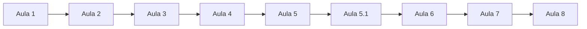

<div align="center">

# ⚙️ Sistemas Operacionais

### Anotações, slides e exercícios da disciplina, aula por aula


</div>

---

## 🪪 Ficha da disciplina

| | |
|:--|:--|
| 🎓 **Aluno** | Kauã Oliveira Lopes |
| 👨‍🏫 **Professor** | Deivison S. Takatu |
| 🏫 **Instituição** | Fatec Itapetininga |
| 📘 **Disciplina** | Sistemas Operacionais |
| 🔗 **GitHub** | [@kaua0083](https://github.com/kaua0083) |

---

## 🧭 Trilha de estudo

O repositório segue a ordem das aulas. Cada pasta guarda o material daquele encontro.



---

## 📂 Índice das aulas

| # | Pasta | Sobre o que é |
|:-:|:------|:--------------|
| 1 | [📁 Aula1](https://github.com/kaua0083/Sistemas-Operacionais-SO/tree/main/Aula1) | Introdução: o que é um SO, para que serve, suas funções e seus tipos |
| 2 | [📁 Aula2](https://github.com/kaua0083/Sistemas-Operacionais-SO/tree/main/Aula2) | _(descrição a preencher)_ |
| 3 | [📁 aula3](https://github.com/kaua0083/Sistemas-Operacionais-SO/tree/main/aula3) | _(descrição a preencher)_ |
| 4 | [📁 aula4](https://github.com/kaua0083/Sistemas-Operacionais-SO/tree/main/aula4) | _(descrição a preencher)_ |
| 5 | [📁 aula5](https://github.com/kaua0083/Sistemas-Operacionais-SO/tree/main/aula5) | _(descrição a preencher)_ |
| 5.1 | [📁 aula5_1](https://github.com/kaua0083/Sistemas-Operacionais-SO/tree/main/aula5_1) | _(descrição a preencher)_ |
| 6 | [📁 aula6](https://github.com/kaua0083/Sistemas-Operacionais-SO/tree/main/aula6) | _(descrição a preencher)_ |
| 7 | [📁 aula7](https://github.com/kaua0083/Sistemas-Operacionais-SO/tree/main/aula7) | _(descrição a preencher)_ |
| 8 | [📁 aula8](https://github.com/kaua0083/Sistemas-Operacionais-SO/tree/main/aula8) | _(descrição a preencher)_ |

---

## 🔎 Resumo da Aula 1: Introdução

<details>
<summary><b>O que é um sistema operacional?</b></summary>

<br>

É o software que fica entre os programas (e o usuário) e o hardware. Ele reparte CPU, memória, disco e periféricos entre quem precisa deles, e faz isso de forma organizada e segura. Sem essa camada, cada programa teria que falar direto com a máquina.

</details>

<details>
<summary><b>De onde ele veio?</b></summary>

<br>

No começo, rodava-se um programa por vez, escrito em baixo nível e sem nenhuma ajuda automática. Para economizar tempo surgiram o processamento em lote (*batch*), depois a multiprogramação e, por fim, os sistemas interativos que usamos hoje.

</details>

<details>
<summary><b>O que ele faz?</b></summary>

<br>

| Área | Responsabilidade |
|:--|:--|
| CPU | Criar, escalonar e encerrar processos |
| Memória | Alocar, liberar e proteger o espaço de cada programa |
| Dispositivos | Controlar periféricos por meio de drivers |
| Arquivos | Criar, ler, escrever, organizar e controlar permissões |
| Interface | Permitir a interação por janelas (GUI) ou comandos (CLI) |

</details>

<details>
<summary><b>Quais são os tipos?</b></summary>

<br>

- **Desktop**: foco em usabilidade (Windows, macOS, distribuições Linux)
- **Servidor**: alta disponibilidade, geralmente sem interface gráfica
- **Móvel**: pensado para toque, sensores e bateria (Android, iOS)
- **Embarcado**: roda em equipamentos dedicados, com poucos recursos

</details>

<details>
<summary><b>O que ele <u>não</u> faz?</b></summary>

<br>

Não cria aplicações, não substitui o hardware, não toma decisões de negócio e não corrige erros de lógica dos programas. Ele gerencia recursos; o objetivo do uso é do usuário.

</details>

---

## 🚀 Como usar este repositório

```bash
git clone https://github.com/kaua0083/Sistemas-Operacionais-SO.git
cd Sistemas-Operacionais-SO
```

Abra a pasta da aula que quiser revisar e siga na ordem para acompanhar a evolução do conteúdo.

---

## 👤 Autor

<table>
  <tr>
    <td align="center">
      <a href="https://github.com/kaua0083">
        <br>
        <sub><b>Kauã Oliveira Lopes</b></sub>
      </a>
    </td>
    <td>
      Estudante de Análise e Desenvolvimento de Sistemas na Fatec Itapetininga.<br>
      Material produzido para estudo da disciplina de Sistemas Operacionais.
    </td>
  </tr>
</table>

---

## 📄 Licença

Distribuído sob a licença MIT. Veja o arquivo [LICENSE.txt](./LICENSE.txt).
